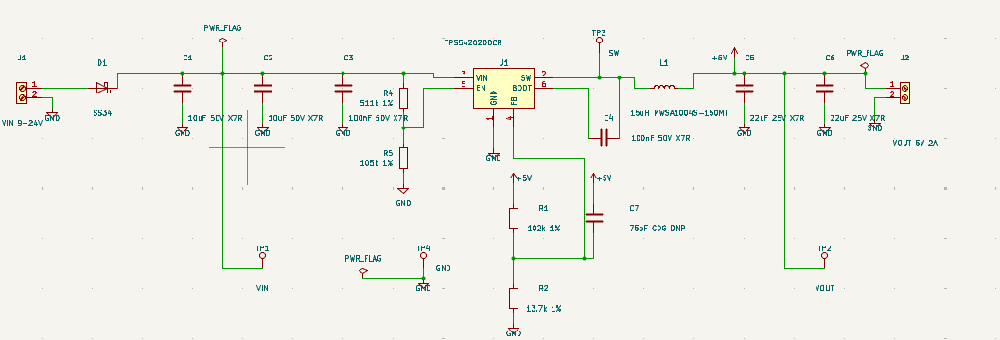
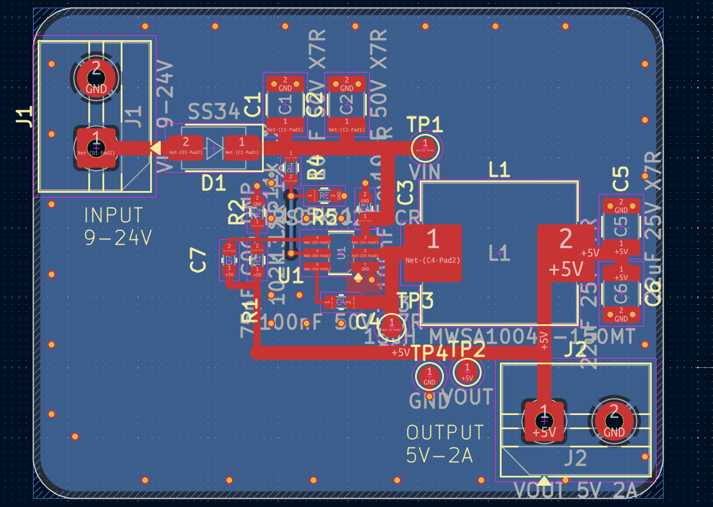
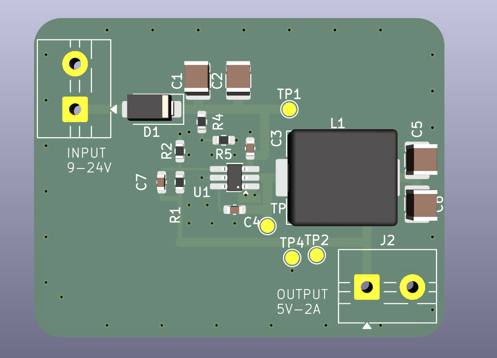

# buck5v: 12 V to 5 V, 2 A Buck Converter (KiCad 10)

A 2-layer synchronous buck converter board built around the Texas Instruments **TPS54202**. Input is 9 to 24 V, output is 5 V at up to 2 A, with a switching frequency of about 500 kHz.

> **Status: designed and checked in software only.**
> The board has not been fabricated, assembled or measured. Every figure below is a calculation from the datasheet, not a bench result. Part sourcing (stock, LCSC numbers) was not verified either.

I built this to learn power-supply design end to end: choosing the IC, calculating each component, wiring the schematic, laying out the board around the switching loop, and checking it with ERC and DRC. I checked the datasheet values and reviewed the schematic, layout and DRC results myself.





## Specification

| Parameter | Value |
|---|---|
| Input voltage | 9 to 24 V (IC accepts 4.5 to 28 V) |
| Output voltage | 5 V (about 5.03 V typical) |
| Output current | 2 A |
| Switching frequency | 500 kHz typical (390 to 630 kHz) |
| Topology | Synchronous buck, integrated FETs |
| Board | 2 layers, 45 x 35 mm |
| Protection | Series Schottky for reverse polarity, EN divider as undervoltage lockout |

## Design

### IC: TPS54202DDCR
4.5 to 28 V input, 2 A, internal high-side and low-side FETs, so no external catch diode is needed. Datasheet values I used: feedback voltage VFB = 0.596 V (0.581 to 0.611 V), switching frequency 500 kHz, low-side current limit up to 4.3 A.

### Output voltage
Vout = VFB x (1 + R1 / R2) = 0.596 x (1 + 102 k / 13.7 k) = **5.03 V** typical.
Over the VFB tolerance the output spans 4.91 to 5.16 V. Both resistors are standard 1% values.

### Inductor
L = 15 uH (Sunlord MWSA1004S-150MT: 45 mOhm DCR max, Isat 5.6 A taken conservatively from the datasheet).

| Vin | Duty cycle | Ripple current (p-p) | Peak current at 2 A load |
|---|---|---|---|
| 9 V | 0.56 | 0.30 A | 2.15 A |
| 12 V | 0.42 | 0.39 A | 2.19 A |
| 24 V | 0.21 | 0.53 A | 2.26 A |

Ripple current = Vout x (1 - D) / (L x f). Peak current stays well below both the inductor's 5.6 A saturation current and the IC's 4.3 A maximum low-side limit.

### Capacitors
| Ref | Value | Role |
|---|---|---|
| C1, C2 | 10 uF 50 V X7R (1210) | Bulk input |
| C3 | 100 nF 50 V X7R (0603) | High-frequency input decoupling, placed at the VIN pin |
| C4 | 100 nF 50 V X7R (0603) | Bootstrap, BOOT to SW |
| C5, C6 | 22 uF 25 V X7R (1210) | Output |
| C7 | 75 pF C0G (0603), not populated | Optional feed-forward across R1 |

Ceramic capacitance falls with DC bias, so the effective output capacitance at 5 V is lower than 44 uF. Output ripple depends mostly on ESR and layout, so it has to be measured on a real board.

### Enable divider (undervoltage lockout)
R4 = 511 k from VIN to EN, R5 = 105 k from EN to GND. With the datasheet EN rising threshold of 1.21 V typical (1.28 V max), the converter starts at about **7.1 V** (7.5 V worst case) at the IC's VIN node. EN sees about 1.5 V at 9 V in and about 4.1 V at 24 V in. Check this against the datasheet's absolute maximum rating for EN before building.

### Reverse-polarity protection
D1 is an SS34 Schottky in series with the input. It costs roughly 0.5 V and about 0.6 W at 9 V in and 2 A out. A P-channel MOSFET would waste less power but needs extra parts.

## Bill of materials

| Ref | Value | Footprint |
|---|---|---|
| U1 | TPS54202DDCR | TSOT-23-6 (hand-solder variant) |
| L1 | 15 uH, MWSA1004S-150MT | Sunlord MWSA1004S |
| D1 | SS34 Schottky | SMA |
| C1, C2 | 10 uF 50 V X7R | 1210 |
| C3, C4 | 100 nF 50 V X7R | 0603 |
| C5, C6 | 22 uF 25 V X7R | 1210 |
| C7 | 75 pF C0G (DNP) | 0603 |
| R1 | 102 k 1% | 0603 |
| R2 | 13.7 k 1% | 0603 |
| R4 | 511 k 1% | 0603 |
| R5 | 105 k 1% | 0603 |
| J1, J2 | 2-pin screw terminal | 5.00 mm pitch |
| TP1 to TP4 | Test points: VIN, VOUT, SW, GND | 1.5 mm pad |

Ordering would need a fresh sourcing pass. Several part numbers (including the inductor) were not confirmed in stock, and the 5.00 mm terminal block should be matched to a real part.

## Layout notes

- The input capacitors sit at the IC's VIN pin. Because SW is between VIN and GND on the 6-pin package, the 100 nF cap's ground return is about 10 mm, so the loop is tight on the VIN side only.
- SW copper is short (about 13 mm in total including the test point). The boot-cap branch off the SW node is about 6 mm, longer than ideal.
- VIN and SW are necked down to 0.65 mm for the first 1.3 to 1.5 mm at the 0.95 mm pin pitch so the 0.25 mm clearance rule holds. Other power traces are 1.0 mm or wider.
- The feedback divider sits near the FB pin, away from SW and L1.
- The bottom layer is a GND plane with stitching vias. The EN trace runs on the bottom layer, short and clear of the switching nodes.
- The TSOT-23-6 has no thermal pad, so heat leaves through the GND pin copper. Thermal performance has not been verified.

## Verification

| Check | Result |
|---|---|
| ERC | 0 errors (PWR_FLAG symbols added to VIN, GND and +5V) |
| DRC | 0 errors, 0 unconnected items at the last run |
| DRC warnings | Mostly stitching vias flagged "not connected on one layer" (the top-layer GND zone only covers a small patch near the IC) and a few silkscreen overlaps |
| Schematic to board sync | No differences |

## Known limitations

- Not built or measured. No efficiency, ripple, thermal or EMI data.
- The top-layer GND pour should cover the whole board. As it stands, the stitching vias outside the patch near U1 only connect to the bottom plane.
- Component sourcing and the 5.00 mm terminal-block part are unverified.
- Ripple and thermal estimates depend on real capacitor ESR and copper area, which this design does not confirm.

## Test plan (if built)

| Test | Setup | What to look for |
|---|---|---|
| Power-up | Bench supply at 12 V, current limit 0.2 A, no load | 5.0 V on TP2, no oscillation or smoke |
| Output accuracy | 9, 12, 24 V in, no load and 2 A load | Output within about +/-3% of 5 V |
| Efficiency | 0.1, 0.25, 0.5, 1, 1.5, 2 A at 9, 12, 24 V | Measure Vin and Iin at the board terminals, Vout and Iout at the load |
| Output ripple | Scope on TP2 with spring ground at TP4, 20 MHz bandwidth | Ripple in mV, compare with the estimate |
| SW waveform | Scope on TP3 | Duty cycle, ringing, frequency near 500 kHz |
| Load step | 0.2 A to 2 A | Overshoot and recovery |
| Thermal | 2 A for 10 minutes, thermal camera or thermocouple | IC and inductor temperature rise |
| Start-up threshold | Slowly raise Vin from 0 | Converter starts near 7 to 7.6 V |

## Repository layout

```
buck5v.kicad_pro        KiCad project
buck5v.kicad_sch        Schematic
buck5v.kicad_pcb        PCB layout
buck5v.kicad_sym        Project symbol library (TPS54202)
sym-lib-table           Library table for the project symbol
docs/                   Images of the schematic, board and 3D view
fab/                    Gerber files, drill files and BOM (CSV)
buck5v-gerbers.zip      The fab/ folder zipped, ready to upload to a board house
```

Open `buck5v.kicad_pro` in KiCad 10 or newer.

## Tools

KiCad 10. Datasheet values were checked by hand against the TI TPS54202 and Sunlord MWSA-S datasheets.

## License

MIT. See [LICENSE](LICENSE). There is no warranty, and nobody has independently reviewed this design. Have it reviewed before building it or using it in anything that matters.
